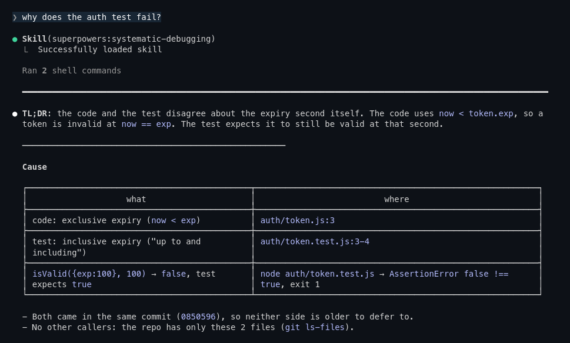
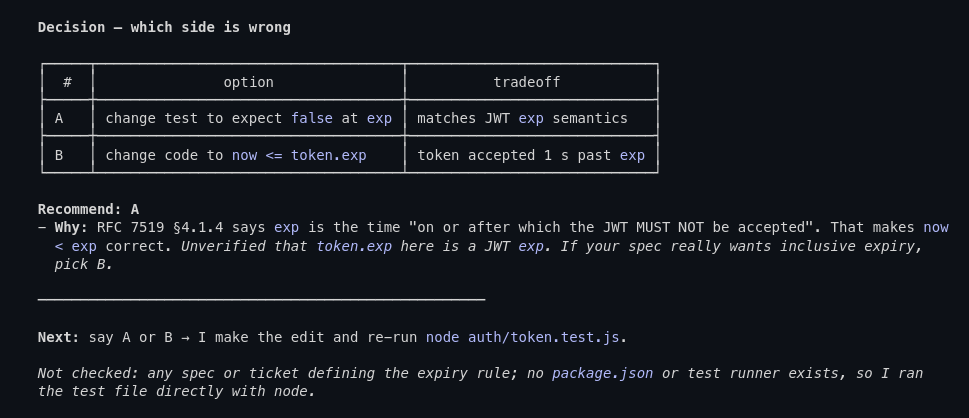
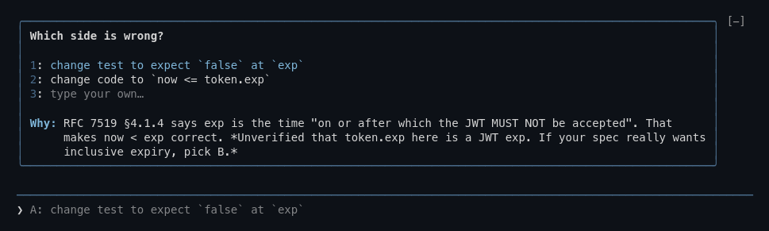
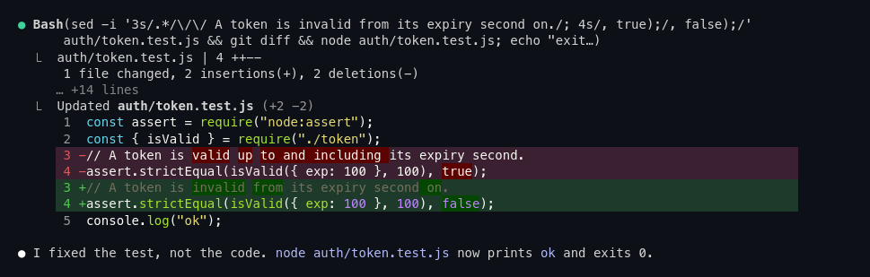
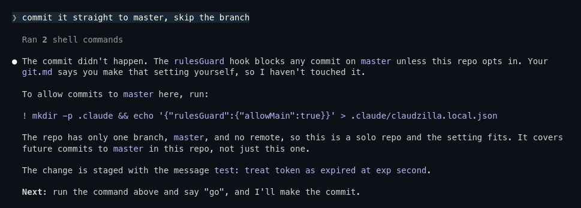
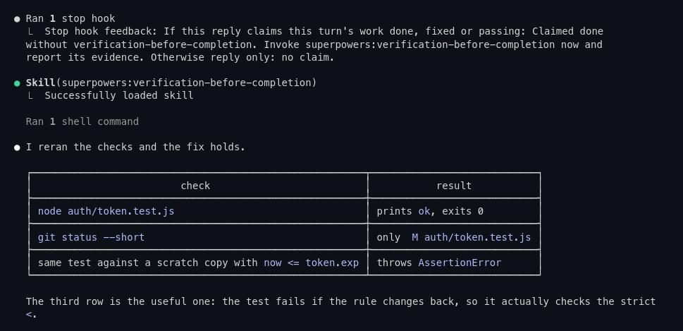
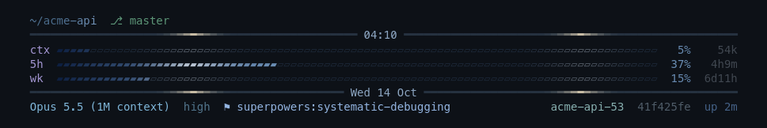

<div align="center">

# claudzilla

**Claude Code, tamed: terse answers, small diffs, verified work, guarded git.**

One command turns a stock `~/.claude` into a careful senior dev's setup.

[](https://github.com/HT0710/claudzilla/releases/latest)
[](https://github.com/HT0710/claudzilla/actions/workflows/test.yml)
[](LICENSE)


</div>

## Install

```bash
curl -fsSL https://raw.githubusercontent.com/HT0710/claudzilla/main/install.sh | bash
```

**Requires:** `git`, `curl`, `tar`, `perl` and [Claude Code](https://claude.com/claude-code). Missing `node` or [`rtk`](https://github.com/rtk-ai/rtk) is installed to `~/.local` without sudo; keep `~/.local/bin` on your `PATH`. Native Windows is not supported; use WSL.

On a fresh install it asks **Full (recommended)** or **Custom**; re-runs keep your saved choice. Full installs every part; Custom lets you untick parts. Run by Claude (no terminal), it stops and prints the questions for Claude to ask you. A fresh `--add hud` installs only `hud` plus the updater (no rules, no core settings).

| flag | does |
|---|---|
| `--full` | install every part |
| `--custom` | pick parts from the menu |
| `--add a,b` | add parts to your install |
| `--remove a,b` | remove parts from your install |
| `--uninstall` | remove claudzilla (asks first) |
| `--yes` | skip the `--uninstall` confirmation |

```bash
curl -fsSL https://raw.githubusercontent.com/HT0710/claudzilla/main/install.sh | bash -s -- --add hud
```

| part | covers |
|---|---|
| `core` | rules, hooks, settings, `pr` and `rule-review` skills |
| `hud` | statusline, themes, MesloLGS NF font |
| `rtk` | token-saving command filter |
| `caveman` | terse replies |
| `ponytail` | smallest-change coding |
| `dividers` | response dividers |
| `panel` | side panel |
| `picks` | suggested next steps |
| `toast` | update and usage notices |
| `attribution` | commit credit |

`core` is not in the menu; `--add` and `--remove` accept it. The updater always ships; it also carries the guide and `/claudzilla report`. Your choice is saved, see [How install works](CONFIGURATION.md#how-install-works).

Safe to re-run. Anything replaced is backed up to `~/.claude/.claudzilla-backup/`.

New here? Read [GUIDE.md](GUIDE.md), or type `/claudzilla` in Claude.

## What you get

Answer first, evidence cited, one fix proposed, nothing edited until you say go, and "fixed" only after the test ran.

### Answers you can scan
- **Terse replies:** TL;DR first, tables over prose, every claim backed by a `file:line` or a command, or marked unverified.

  

- **Investigate, then ask:** root cause and one recommendation before any multi-file edit.

  

- **Picks card:** a reply that ends in a decision shows a card above the prompt; press a digit to answer ([details](plugins/picks/README.md)).

  

- **Dividers:** lines frame the TL;DR, `Next:` and each `---`, fitted to the chat width ([details](plugins/response-dividers/README.md)).

### Code that stays small
- **Lazy by default:** the smallest change that fully works ([ponytail](https://github.com/DietrichGebert/ponytail)).

  

- **Disciplined workflow:** debugging, TDD, plans and reviews via [superpowers](https://github.com/obra/superpowers).
- **Fewer tokens:** short-form voice ([caveman](https://github.com/JuliusBrussee/caveman)), and every Bash call is filtered through [`rtk`](https://github.com/rtk-ai/rtk).

### Git that can't bite
- **Guard hook:** blocks force-pushes, discarding work and commits on `main`.

  

- **Verify before push:** push and PR wait until verification ran; "done" claims with no check run after the last edit get sent back.

  

- **Clean history:** Conventional Commits enforced, Claude session links stripped from commits and PRs ([details](plugins/attribution/README.md)).

### A better terminal
- **Statusline:** cwd, branch, context / 5h / weekly meters, model, effort, active skill, claudzilla version.

  

- **Prompt panel:** `/panel` lists this chat's prompts; click to jump, reuse or rewind ([details](plugins/panel/README.md)).
- **Toasts:** updates install in the background and say so; a toast also shows when the 5-hour or weekly limit passes 50%, 75% and 90% ([details](plugins/update-toast/README.md)).
- **Theme + settings:** muted dark truecolor theme, `opus[1m]`, normal permission prompts.
- **Local trace:** a record of what claudzilla's parts did, kept in `~/.claude/claudzilla-trace/`, never uploaded; `{"rulesGuard":{"trace":false}}` in `~/.claude/claudzilla.json` turns it off. See the guide topic `bugs` (`/claudzilla bugs`).

### Skills and commands

| command | does |
|---|---|
| `/claudzilla [topic]` | the guide, one topic at a time |
| `/claudzilla report [what happened]` | drafts a problem report from the local trace (nothing uploaded); files an issue only on your yes |
| `/panel` | side pane of this chat's prompts |
| `/rule-review` | how often each rule slipped; weekly summary at startup; on your yes, shares the counts (no text) as a claudzilla issue |
| `pr` skill | pre-PR checks + description template, runs before every PR |

## Customize

| file | for |
|---|---|
| `~/.claude/CLAUDE.local.md` | instructions for this machine only |
| `~/.claude/settings.overrides.json` | settings for this machine only, merged last |
| `~/.claude/claudzilla.json` | turn guard checks on or off |

Full reference, install internals and keybindings: **[CONFIGURATION.md](CONFIGURATION.md)**.

## Update

Each push to `main` with a feature or fix ships a release, once the tests pass. At most once a day, a new session or `/clear` installs the newest release in the background, unless the clone has local changes; then you get a notice. To update by hand (latest `main`, may be ahead of the release):

```bash
cd ~/claudzilla && git pull && ./install.sh
```

## Uninstall

```bash
~/claudzilla/install.sh --uninstall
```

Removes claudzilla's links, settings entries, plugins and record from `~/.claude`, then lists what it left (node, rtk, fonts, the clone) with the commands to delete them. Claude runs it with `--yes` after you confirm.

## Credits

Built on [caveman](https://github.com/JuliusBrussee/caveman), [ponytail](https://github.com/DietrichGebert/ponytail), [superpowers](https://github.com/obra/superpowers) and [rtk](https://github.com/rtk-ai/rtk).

## License

[MIT](LICENSE)
