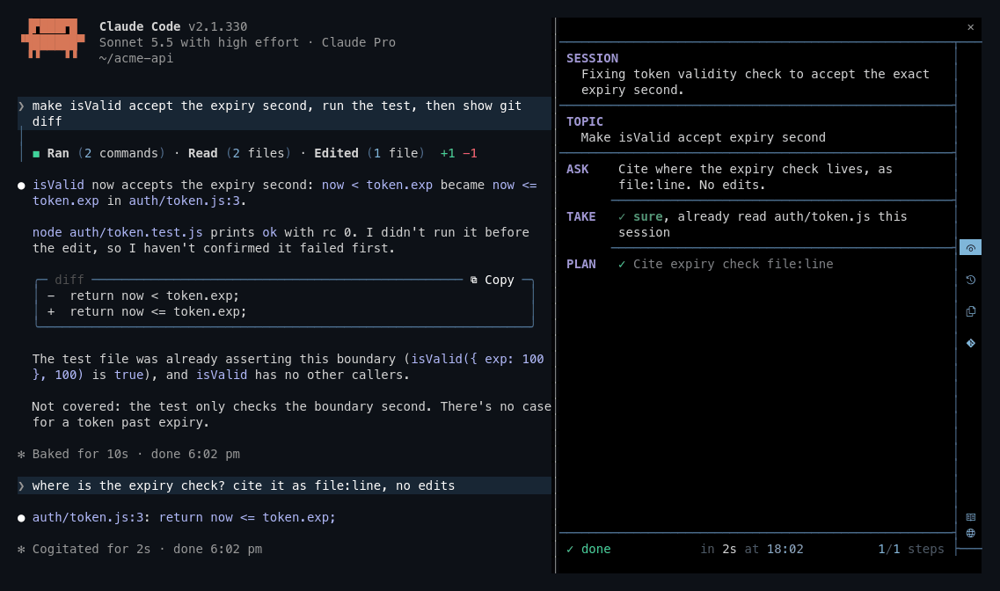
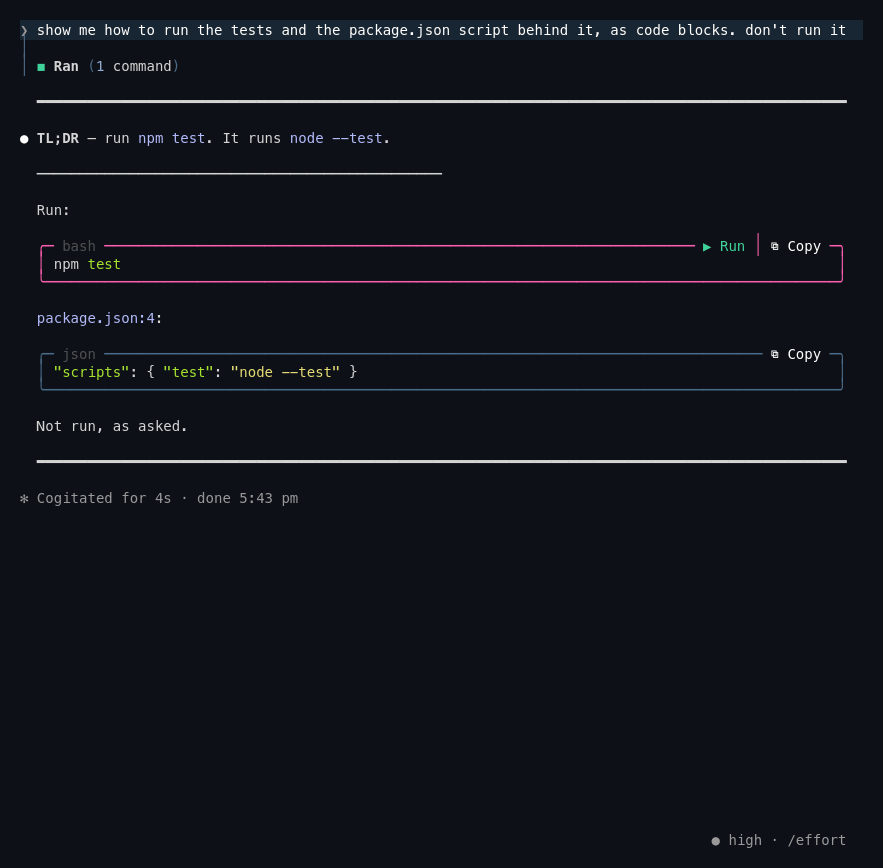
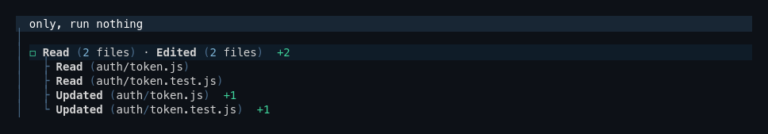

# folio

Draws the lines claudzilla's `md-display.pl` puts in a reply (the heavy frame, the thin separator, the dotted group break) at the chat's current width. Lines a hook prints keep the width they were printed at and wrap once the chat narrows, as when the margin docks or the terminal shrinks; drawn here, they follow every resize.

A reply still streaming is drawn before this plugin sees it, so the plugin saves the chat's width in `$TMPDIR/claudzilla-rules-<uid>/cols-<session id>`, a folder only you can read or write, and `md-display.pl` draws the streaming lines at that width. Without the plugin, `md-display.pl` uses the full terminal width.

It redraws any whole line of `━`, `─` or `┈` outside a code fence, so a line the model writes itself is resized too. Without `md-display.pl` replies rarely hold such lines and it draws nothing.

It also turns a code span holding an existing file path (`path`, `path:line` or `path:line-line`) into a link. Click opens it on the margin's Explorer tab; the terminal's own link click (such as ctrl+click) opens the file; Claude Code itself ignores modifier clicks on it. Commands, flags, directories and missing files stay plain. Needs the fullscreen layout. Without the margin part, a click shows a toast saying so.

*Real speed. Click `auth/token.js:3`: the Explorer tab opens on it.*

Each code block is drawn in a card: the language on the top edge, then a Copy button, which puts the block on the clipboard and reads `✓ Copied` for 2 seconds. A `bash`, `sh`, `zsh`, `shell` or `console` block also gets Run, and its edge takes the theme's bash colour. The first click arms Run (`▶ Run? click again`, for 3 seconds), so a stray click or a double-click runs nothing; the second runs the block with `bash -c`, so pipes, `if` blocks and heredocs work as written. A block with `$ ` prompts gives only those lines, without the `$ `.

The output streams into the card as the command writes it. The card shows the last 20 lines, and `exit N` beside `output` when the command fails. While it runs, Run reads `■ Stop`, which ends the command. Once a block has run, `▶ Run again` runs it on one click, because you have already seen the command. Once the command ends, the output line gets its own Copy, which takes all of the output, and Hide, which takes the output off the card.

A card with a line wider than itself also gets `↩ Wrap`. On a shell card it wraps the Run output; on any other card it wraps the code. Rows break at a space when they can, and `→ Unwrap` puts the cut lines back. A card stays wrapped when you press Run again. A URL that fits the card moves whole to the next row. A longer one splits, and each piece links to the full URL. A wrapped output line shows its first 20 rows, then `… +N rows`.

*2× speed. Click Run twice: the tests stream into the card. The json block gets only Copy.*

The output keeps its colours. A run sets `FORCE_COLOR=1` and `CLICOLOR_FORCE=1`, so tools that read them print colour without a terminal; GNU `ls`, `grep` and `git` still need `--color=always`. Copy and Claude's row get the output without colour codes.

When the command ends, a row like a typed `!` command's leaves the output for Claude, its last 30,000 characters if it is longer. Hide does not take that row back, and a stopped run's row says it was stopped. A mod cannot put the prompt box in shell mode, so the plugin runs the command itself and never touches the box. Like a typed `!`, a run skips Claude's permission rules. It gets no terminal and empty input, so a command that asks for input, such as `sudo` or `ssh`, fails instead of waiting. On macOS, which has no `setsid`, a command that opens the terminal itself can still draw over Claude Code. Use a typed `!` for those. The shown output is gone after a restart; Claude keeps its copy. A reply still streaming shows its code blocks plainly until it ends.

In the fullscreen layout every finished read, search, fetch, command, edit, task stop and MCP call folds into one row with a count per kind, even a single call: `◼ Edited (1 file)  +12 −3`, `◼ Ran (1 command)`, or `◼ Read (2 files) · Ran (3 commands)  +1 −1` for a run of calls with nothing between them. A command that writes files adds `Edited (N files)` beside `Ran`. The `◼` mark turns to `◻` when the row is open, and takes the colour of the worst call: blue and blinking while a call runs, red when one failed, gray when one was interrupted, green when all are done. While a kind runs, it reads `Reading`, `Searching` or `Running`, and a failed call adds `· 1 failed`. Click the row to open a tree with a row per changed file, and the command or `Read (a.txt)` for the other calls, a stopped task showing its command, with the first three lines of a failed call's error text under it. Click a file to see its diff in place. A script's output shows under its row in the tree: the first 3 lines, then a count of the rest.

Some rows keep their own drawing. A running call reads `● Updating (a.txt)` with a blinking dot, as does a running fetch, search, agent or skill, such as `● Fetching (example.com)`. A single call that fails or is interrupted keeps its native row, a failed or denied edit keeps its reason, and a refusal or a change held for review draws as usual. A command that writes files and then fails draws `● Ran (make)  failed  +1 −1`, with its error output under the row. Agents draw `◆ done     sleepy-lynx (Fix the tests)  in 12s` when named, and a call with no name keeps `builder (Fix the tests)`. A row that is still going adds `as haiku medium` for its model and effort. The label takes the agent type's colour from Overview's PLAN. A background command's notification, including one moved there after its timeout, folds to `◼ Ran (1 command)  done · 3s`, `failed` when it exits non-zero, or `stopped`. Click it to see the command's first line. Off the fullscreen layout it reads `◼ Bash (sleep 3; echo hi)  done · 3s`. After a resume it keeps the native text. Agents launched together share the engine's `N background agents launched` row, which a plugin can't redraw.

Folio finds a command's writes from its text, such as `sed -i` or `echo x > a.txt`. In a git repo inside the session folder it also finds the writes of a command it can't read, such as a script, by comparing `git status` and the dirty files before and after it. After a reload or resume folio has no record of a command's writes, so the row has no counts unless the engine sends its own diff.

Off the fullscreen layout a printed row can't change, so nothing folds or opens. Each edit keeps its own row, `● Updated (a.txt)  +12 −3` or `● Created (a.txt)  +3` for a new file, a command that writes files keeps one row per file, and a fetch reads `● Fetched (example.com)  200 · 577 B`.

Tool rows sit 2 columns in, and a `│` rail runs down the left edge from your prompt or Claude's text through the rows after it, until the next reply. An agent row forks off the rail with `├─`, or `╰─` when it is the last row under it; a background agent's launch row uses `├┄` and its finish row a solid `├─` or `╰─`. A skill loaded into the chat sits on the rail as a node, `✦ loaded   caveman-help (caveman)`, with the `✦` in place of the `│`; a skill that runs as its own agent draws like an agent row, `├─✦ done     review (superpowers)`. ctrl+o and `--verbose` still draw every diff. Set `hideEditDiff` to `false` to keep diffs in the chat ([CONFIGURATION.md](../../CONFIGURATION.md)).

*Two edits in one turn fold into one row; a click opens the tree. Click a file to see its diff.*

## Install

claudzilla's `install.sh` installs it.

## Needs

Tested with Claude Code 2.1.312; mod events and methods can change between releases.

## Develop

`claude --plugin-dir plugins/folio` loads it and writes the API types `tsconfig.json` points at; `claude plugin test plugins/folio` runs the tests.
