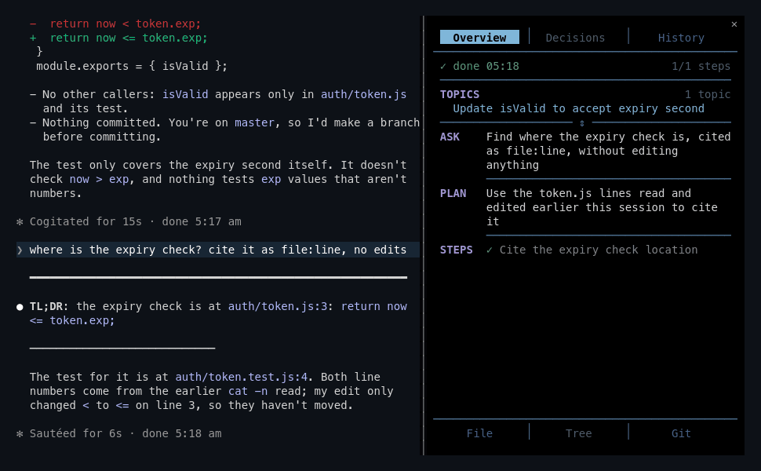
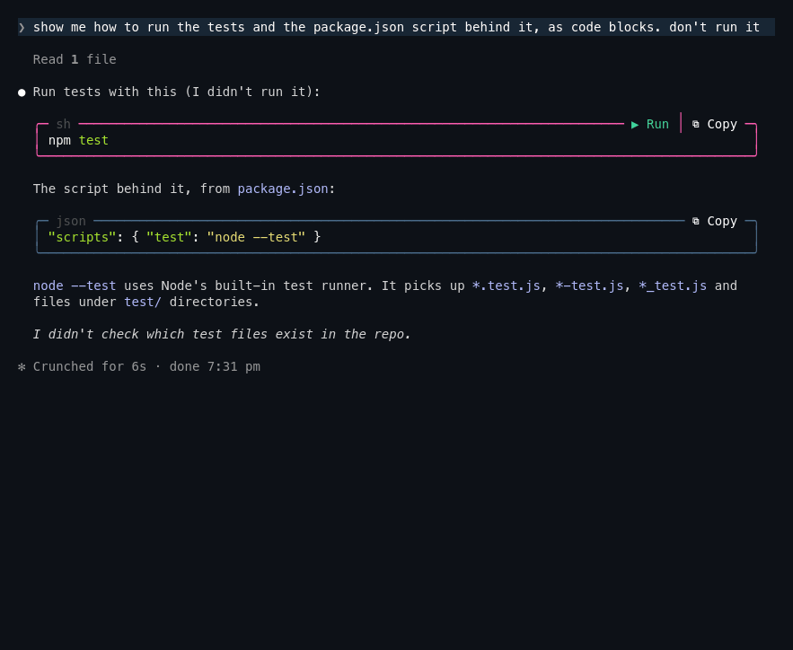

# folio

Draws the lines claudzilla's `md-display.pl` puts in a reply (the heavy frame, the thin separator, the dotted group break) at the chat's current width. Lines a hook prints keep the width they were printed at and wrap once the chat narrows, as when the margin docks or the terminal shrinks; drawn here, they follow every resize.

A reply still streaming is drawn before this plugin sees it, so the plugin saves the chat's width in `$TMPDIR/claudzilla-rules/cols-<session id>` and `md-display.pl` draws the streaming lines at that width. Without the plugin, `md-display.pl` uses the full terminal width.

It redraws any whole line of `━`, `─` or `┈` outside a code fence, so a line the model writes itself is resized too. Without `md-display.pl` replies rarely hold such lines and it draws nothing.

It also turns a code span holding an existing file path (`path`, `path:line` or `path:line-line`) into a link. Click opens it on the margin's File tab; the terminal's own link click (such as ctrl+click) opens the file; Claude Code itself ignores modifier clicks on it. Commands, flags, directories and missing files stay plain. Needs the fullscreen layout. Without the margin part, a click shows a toast saying so.

*Real speed. Click `auth/token.js:3`: the File tab opens on it.*

Each code block is drawn in a card: the language on the top edge, then a Copy button, which puts the block on the clipboard and reads `✓ Copied` for 2 seconds. A `bash`, `sh`, `zsh`, `shell` or `console` block also gets Run, and its edge takes the theme's bash colour. The first click arms Run (`▶ Run? click again`, for 3 seconds), so a stray click or a double-click runs nothing; the second runs the block with `bash -c`, so pipes, `if` blocks and heredocs work as written. A block with `$ ` prompts gives only those lines, without the `$ `.

The output streams into the card as the command writes it. The card shows the last 20 lines, and `exit N` beside `output` when the command fails. While it runs, Run reads `■ Stop`, which ends the command. Once a block has run, `▶ Run again` runs it on one click, because you have already seen the command. Once the command ends, the output line gets its own Copy, which takes all of the output, and Hide, which takes the output off the card.

*2× speed. Click Run twice: the tests stream into the card. The json block gets only Copy.*

The output keeps its colours. A run sets `FORCE_COLOR=1` and `CLICOLOR_FORCE=1`, so tools that read them print colour without a terminal; GNU `ls`, `grep` and `git` still need `--color=always`. Copy and Claude's row get the output without colour codes.

When the command ends, a row like a typed `!` command's leaves the output for Claude, its last 30,000 characters if it is longer. Hide does not take that row back, and a stopped run's row says it was stopped. A mod cannot put the prompt box in shell mode, so the plugin runs the command itself and never touches the box. Like a typed `!`, a run skips Claude's permission rules. It gets no terminal and empty input, so a command that asks for input, such as `sudo` or `ssh`, fails instead of waiting. On macOS, which has no `setsid`, a command that opens the terminal itself can still draw over Claude Code. Use a typed `!` for those. The shown output is gone after a restart; Claude keeps its copy. A reply still streaming shows its code blocks plainly until it ends.

## Install

claudzilla's `install.sh` installs it.

## Needs

Tested with Claude Code 2.1.308; mod events and methods can change between releases.

## Develop

`claude --plugin-dir plugins/folio` loads it and writes the API types `tsconfig.json` points at; `claude plugin test plugins/folio` runs the tests.
