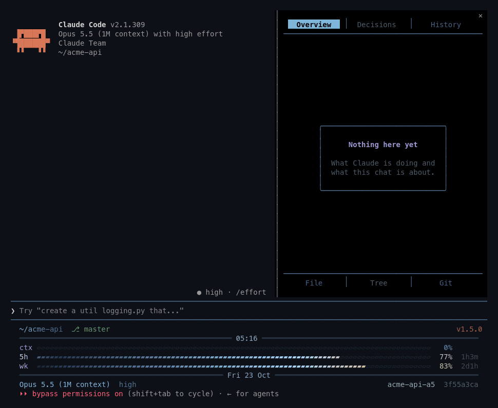
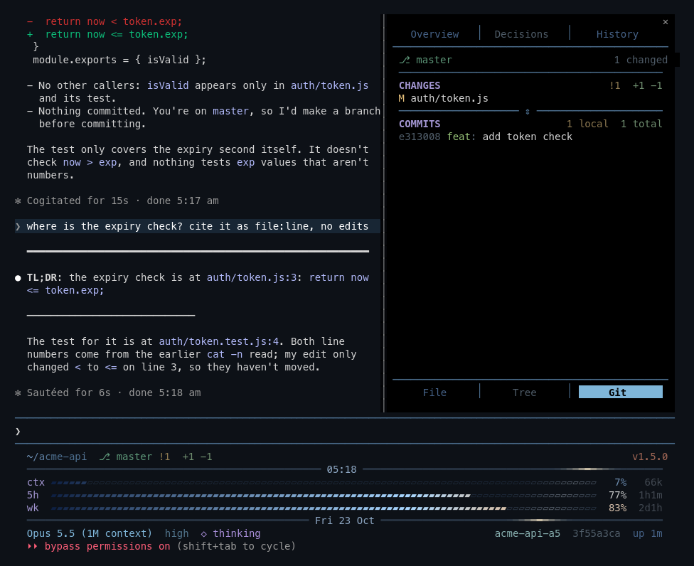

# margin

A side pane that opens on its Overview tab, at session start as the last session left it (open the first time; under 144 columns it waits for room, 110 once you have opened it yourself; a tab key shows it at any width); the History tab lists this chat's prompts, newest first. Two tab bars: Overview, Decisions and History (this chat) on top; File, Tree and Git (the repo) below. Decisions and Tree are dimmed: coming in v1.8.



*2× speed. Each step report is a short tool call; while the Overview tab shows, an Opus request at low effort after each prompt sorts topics.*



- **Click a prompt:** the chat scrolls to it.
- **`↻`:** puts the prompt back in the prompt box.
- **`⟲ rewind`:** opens the `/rewind` picker.
- **`⤓ latest`:** scrolls the chat to its newest row, as ctrl+end does. Both show once there is a prompt, and are hidden while History is empty.
- **Wheel:** scrolls the prompts under the tabs and header. Scrolled, a `↑` line under the header, or a new prompt, goes back to the top.
- **Lit prompt:** the one whose turn is on screen. Needs the fullscreen layout.
- **Dim prompt:** rewound or compacted (a `Rewound` or `Compacted` line marks where), or not drawn in the chat yet. `↻` still works.
- **File tab:** the lines around the line a link in Claude's reply points at, the line marked `▶` in the middle. Click a file link in a reply (needs the folio part) to open it; opens the margin if closed. Fullscreen layout only.
- **Git tab:** the session folder's branch (`↑` ahead, `↓` behind), changed files and recent commits. The wheel scrolls the list under it; scrolled, a `↑` line goes back to the top of CHANGES or COMMITS. Redraws after each tool call and prompt. A pushed commit's id, or the branch once pushed to origin, is a link to its page on GitHub, GitLab, Codeberg or SourceHut, its row lit while the pointer is on it. Alt+click opens it: Ctrl+click opens it twice until [anthropics/claude-code#76110](https://github.com/anthropics/claude-code/issues/76110) is fixed.
- **Overview tab:** what this chat is about (TOPICS: Opus groups your prompts, and only your prompts, into topics, after each prompt while the tab shows; past 30 it combines the most closely related), how Claude read your request (ASK), what it plans (PLAN) and its steps (STEPS), in Claude's own words and in your language, labels aside: the margin adds a hidden `intent` tool and asks Claude to call it first in each turn, and again as each step completes or the plan changes. The report comes first in each message, so the tab updates before that message's other tools run; when the turn ends with an answer, every step shows done. Agents Claude starts show under their step, one row each with a mark for planned, working, done, failed or stopped; past 3 they fold into a count you click to open. Clicking an agent opens its transcript; clicking it again, its step, or Esc goes back. The header reads `● working`, `✓ done`, `■ stopped`, or `◌ waiting on N agents` when the turn ended with background agents still running. From submit until Claude reports, it reads `planning…` over last turn's dimmed report; the current step is lit (blue in the claudzilla theme). Costs a short tool call per report. The `intent` option in `/config` turns it off from the next session. When STEPS runs past the pane's last row, a dim `… N more` counts the rows left out (drag the `⇕` rule up for more). The wheel scrolls TOPICS; scrolled, a `↑` line goes back to the top.
- **`⇕` rule:** under CHANGES and under TOPICS. Drag it to share the rows, each side keeping at least one; click it to move it to the top, and click it there to move it to the bottom.

## Install

claudzilla's `install.sh` installs it. Without claudzilla:

```
/plugin install margin --marketplace HT0710/claudzilla
```

## Open it

`/margin` toggles the pane. A tab key (alt+o Overview, alt+h History, alt+l File, alt+g Git) opens it on that tab, switches to the tab when another shows, and closes it when that tab already shows. claudzilla's `install.sh` binds them unless you bound a key or gave its command another key. Without claudzilla, add this to `~/.claude/keybindings.json`:

```json
{
  "bindings": [
    { "context": "Chat", "bindings": {
      "alt+o": "command:margin-overview",
      "alt+h": "command:margin-history",
      "alt+l": "command:margin-file",
      "alt+g": "command:margin-git"
    } }
  ]
}
```

On macOS `alt` is Option; your terminal must send it as Meta — see [Option key shortcuts](https://code.claude.com/docs/en/terminal-config#enable-option-key-shortcuts-on-macos).

## Needs

Tested with Claude Code 2.1.312; mod events and methods can change between releases.

`git` (Git tab), `tail` (`⤓ latest`) and `find` (agent transcripts) on `PATH`, and `grep`: without it, the list still shows, read whole from the prompt history (up to 4 MiB), and a click finds only prompts already drawn.

## Develop

`claude --plugin-dir plugins/margin` loads it and writes the API types `tsconfig.json` points at; `claude plugin test plugins/margin` runs the tests.
