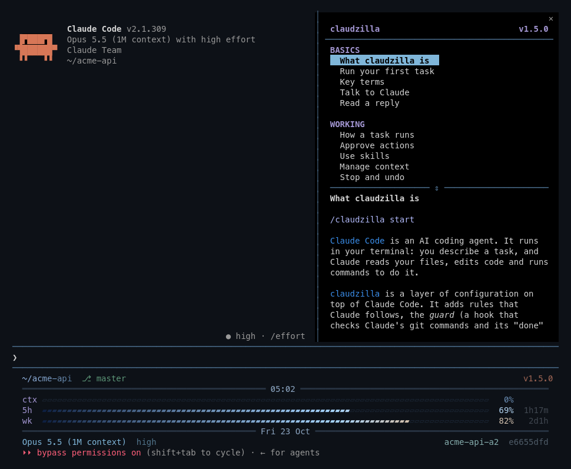

# guide

Adds `/claudzilla`: a pane listing the guide's topics, grouped by part, with the picked section drawn as markdown. `/claudzilla <topic>` opens that topic. The mouse wheel scrolls the topic list or the section, whichever is under the pointer; the scroll keys move the section. In a narrow pane the topics stack over the section: drag the `⇕` divider between them to resize.

`/claudzilla` with no topic toggles the pane. claudzilla's `install.sh` binds alt+g unless you bound it. Each section shows its topic name under its title.

`/claudzilla report [what happened]` has Claude draft a problem report from the local trace (`claudzilla-report` skill). `/claudzilla compact` has Claude draft a `/compact` line naming what to keep and drop; its `compact_draft` tool puts the line in the prompt box when the turn ends.

It finds the claudzilla clone through the `~/.claude/hooks/claudzilla-update.sh` link (as herald does), reads `GUIDE.md` from it, and shows the version as the status line does. With no clone or no `GUIDE.md`, it shows the GitHub URL of `GUIDE.md`.

## Install

claudzilla's `install.sh` installs it.

## Needs

Tested with Claude Code 2.1.308; mod events and methods can change between releases. `sh`, `git` and `readlink -f` on the PATH.

## Develop

`claude --plugin-dir plugins/primer` loads it and writes the API types `tsconfig.json` points at; `claude plugin test plugins/primer` runs the tests.
